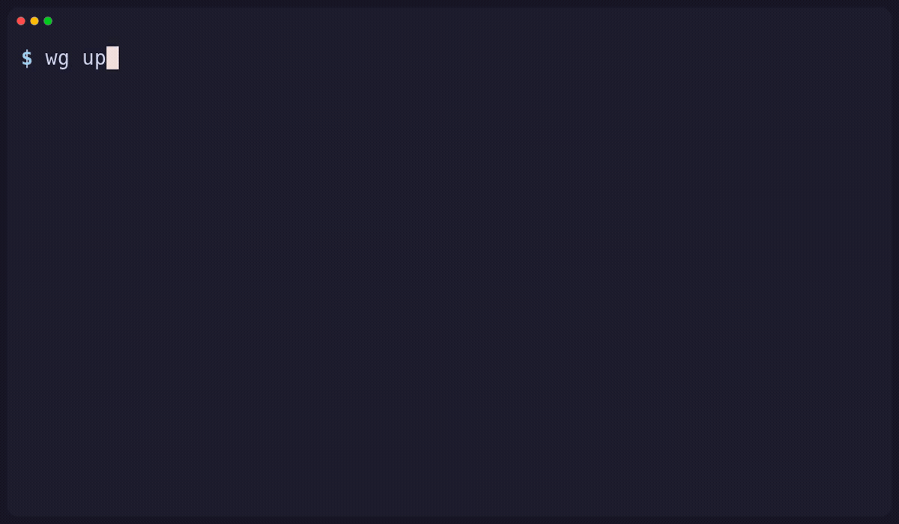
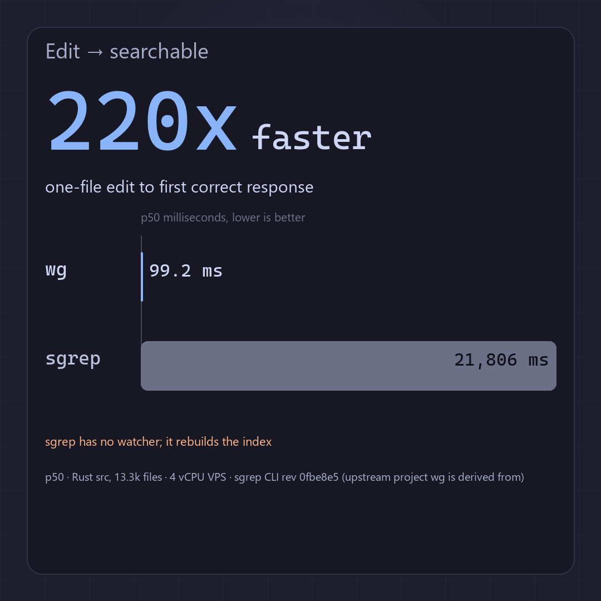
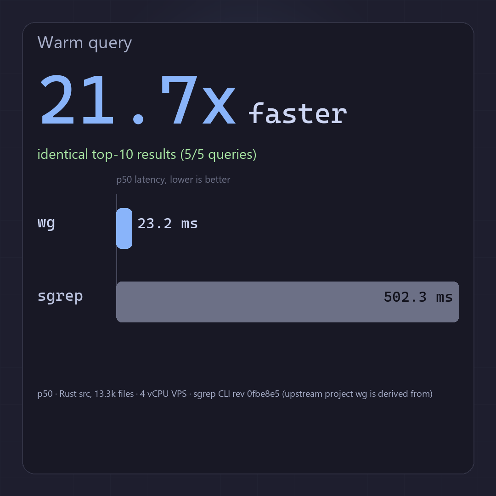
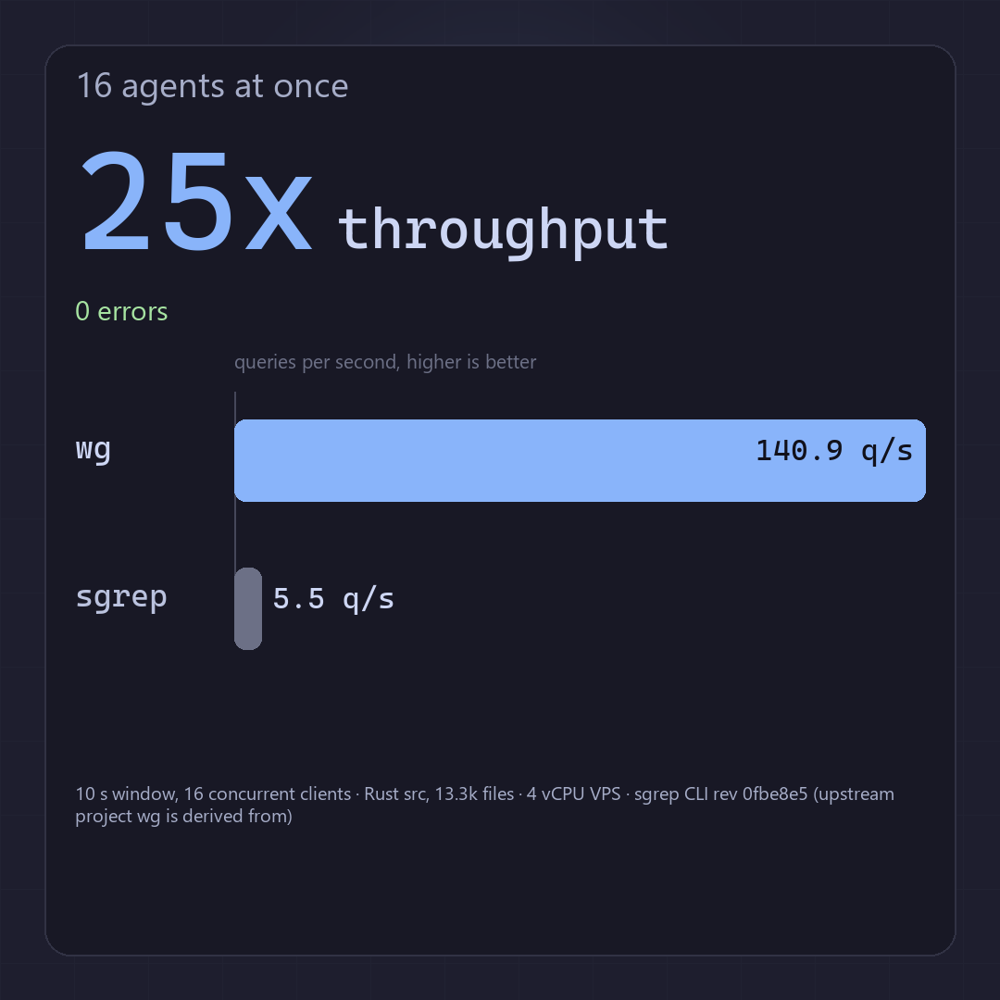
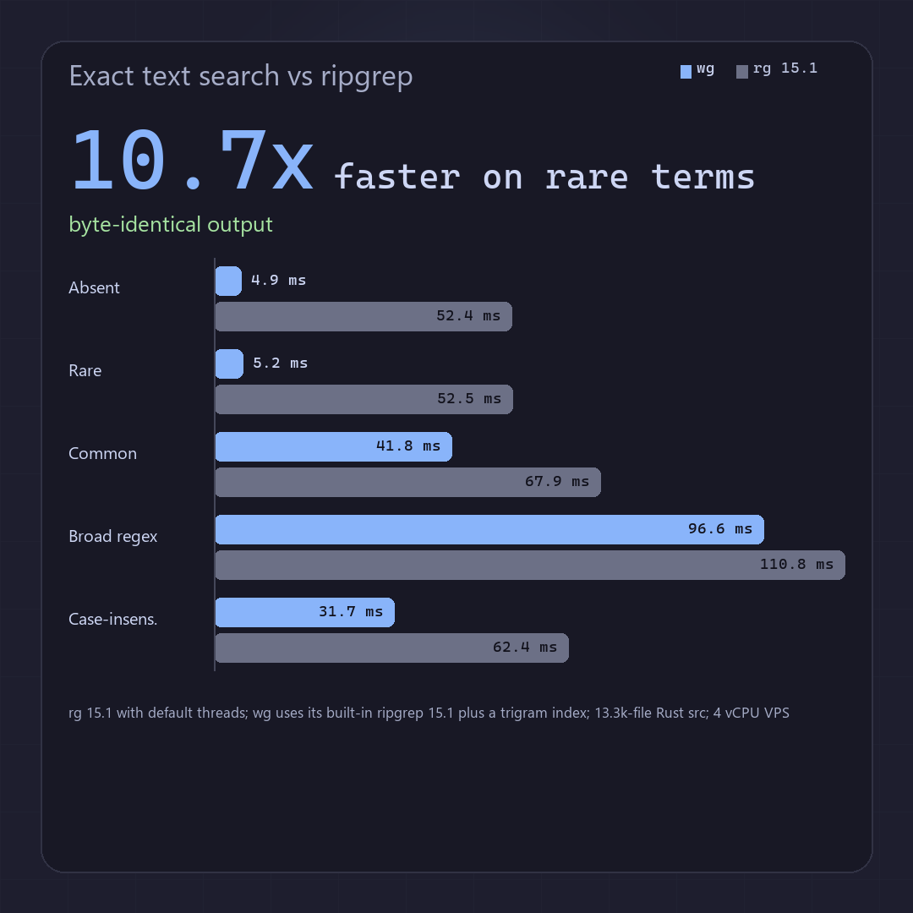
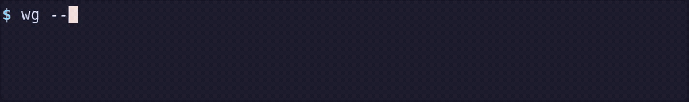
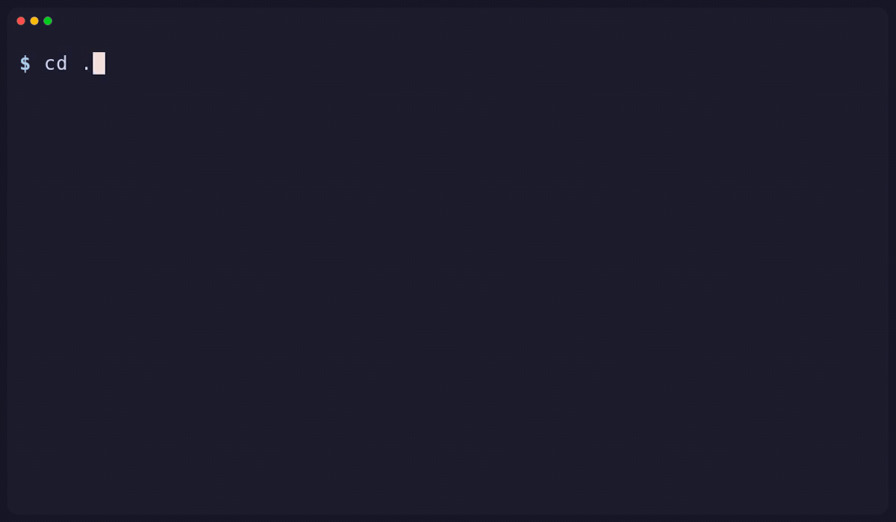

<p align="center">
  <picture>
    <source media="(prefers-color-scheme: dark)" srcset="docs/media/logo-dark.svg">
    
  </picture>
</p>

<p align="center">
  Semantic and exact code search for agents. One local binary, live indexes, built-in ripgrep 15.1.
</p>

<p align="center">
  <a href="https://github.com/holdfast-labs/wgrep/actions/workflows/ci.yml?query=branch%3Amain"></a>
  <a href="https://github.com/holdfast-labs/wgrep/releases/latest"></a>
  <a href="LICENSE"></a>
  
  
</p>

<p align="center">
  <a href="#install">Install</a> ·
  <a href="#quick-start">Quick start</a> ·
  <a href="#demos">Demos</a> ·
  <a href="docs/benchmarks.md">Benchmarks</a> ·
  <a href="#docs">Docs</a>
</p>

<p align="center">
  
</p>

## Why wg

- **220× faster edit-to-first-result**: 99 ms p50, against 21.8 s p50 for sgrep, which rebuilds its index.
- **22× faster warm queries**: 25 ms p50, against 566 ms p50 for the sgrep CLI; identical top-10 rows and scores on 5/5 queries.
- **141 vs 5.5 q/s with 16 concurrent agents**: 25× the throughput, with zero errors.
- **10.6× faster than rg on rare terms**: 6.0 ms vs 63.8 ms p50, with byte-identical output under `--sort path`.

<table align="center">
  <tr>
    <td align="center"></td>
    <td align="center"></td>
  </tr>
  <tr>
    <td align="center"></td>
    <td align="center"></td>
  </tr>
</table>

*One 4-vCPU Linux VPS; methods and limits in [docs/benchmarks.md](docs/benchmarks.md).*

## Install

| Platform | Archive |
| --- | --- |
| Linux x64 | [wg-0.1.0-linux-x64.tar.gz](https://github.com/holdfast-labs/wgrep/releases/latest/download/wg-0.1.0-linux-x64.tar.gz) |
| Windows x64 | [wg-0.1.0-windows-x64.zip](https://github.com/holdfast-labs/wgrep/releases/latest/download/wg-0.1.0-windows-x64.zip) |
| macOS arm64 | [wg-0.1.0-macos-arm64.tar.gz](https://github.com/holdfast-labs/wgrep/releases/latest/download/wg-0.1.0-macos-arm64.tar.gz) |
| macOS x64 | [wg-0.1.0-macos-x64.tar.gz](https://github.com/holdfast-labs/wgrep/releases/latest/download/wg-0.1.0-macos-x64.tar.gz) |

```sh
tar -xzf wg-0.1.0-linux-x64.tar.gz    # or a macOS archive
cd wg-0.1.0-*/
export PATH="$PWD/bin:$PATH"
wg --version
```

```powershell
Expand-Archive wg-0.1.0-windows-x64.zip -DestinationPath .
$dir = (Get-ChildItem wg-0.1.0-windows-x64-* -Directory)[0].FullName
$env:PATH = "$dir\bin;$env:PATH"; wg --version
```

From a clone: `cargo install --locked --path . --bin wg`.

Or install directly from the repository:

```sh
cargo install --locked --git https://github.com/holdfast-labs/wgrep wgrep --bin wg
```

## Quick start

```sh
cd path/to/repo
wg up                                          # attach the root; build the indexes
wg "where do incoming requests get validated"  # semantic, the default
wg -F "decodePacketV17" .                      # exact text, ripgrep flags
wg status                                      # roots, counts, health
wg down                                        # stop the shared daemon
```

The first semantic run downloads about 58 MB of model and parser assets. The
text route needs no model and no daemon. Full details are in
[docs/usage.md](docs/usage.md).

## Demos

**Live index.** Real code, recorded at 1x: the edit is searchable before the next prompt returns.



**One daemon, many repos.** Real code in two repositories; one process, one model.



## Two routes

| | Semantic | Exact text |
| --- | --- | --- |
| **Trigger** | `wg QUERY` with no ripgrep flag (the default) | A flag outside the `wg` set, such as `-F`, `-e`, `-n`, `-l`, `-g`, or `--files` |
| **Engine** | Shared daemon; local code model; fused BM25 and embedding rank | Built-in ripgrep 15.1, in the `wg` process |
| **Daemon** | Required (`wg up`) | Optional; a live daemon adds trigram pruning |

Semantic results are ranked, not exhaustive. Use `-F` or `-e` when you need
every match.

## For agents

- Ranked intent: `wg "where do requests get validated" --top 10`.
- Exhaustive truth: `wg -F "needle" .`; always pass a path.
- Machine output: `wg up --json` and `wg status --json`; exit 0 match, 1 none, 2 error.

Read [docs/agent-guide.md](docs/agent-guide.md) and [llms.txt](llms.txt).

## Docs

- [Usage and details](docs/usage.md)
- [How it works](docs/how-it-works.md)
- [Agent guide](docs/agent-guide.md)
- [Benchmarks](docs/benchmarks.md)
- [Release process](docs/release.md)

## Credits

- [sgrep](https://github.com/mrmps/sgrep) by mrmps: semantic ranking. MIT license. Pinned revision `0fbe8e5`.
- ripgrep 15.1: text engine and walker. MIT or Unlicense.
- notify: filesystem watcher. CC0.

The recordings are real VHS tapes in [docs/demos](docs/demos/README.md); MP4
versions are in `docs/media`.

## License

`wg` is MIT licensed. Copyright (c) 2026 Holdfast Labs. See [LICENSE](LICENSE)
and [NOTICE](NOTICE) for third-party components.
