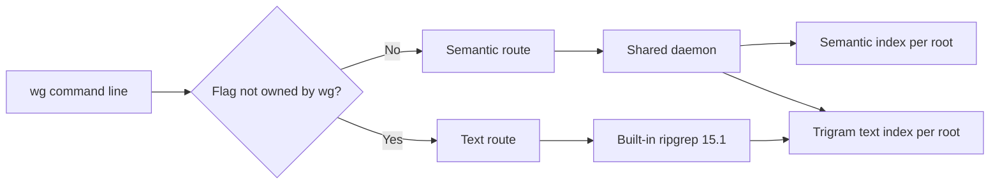
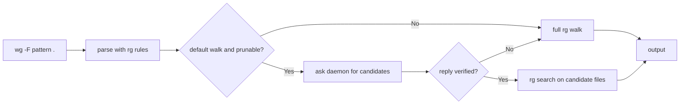

# How wg works

`wg` is one binary with two search routes. Both can use one background daemon.
This page explains the main parts for technical readers.



## 1. One binary, two routes

`src/lexical.rs` classifies the command line before any index work starts. It
returns `Semantic`, `Lexical`, `Service`, `Daemon`, `Help`, or `Version`.

The classifier knows the flags that `wg` owns: `--json`, `--explain`, `-h`,
`--help`, `-V`, `--version`, `--top`, `-k`, `--model`, and `--cache-dir`. A flag
outside that set selects the text route.

A bare `wg PATTERN` has no flags, so it stays semantic. `wg QUERY --json` also
stays semantic because `--json` alone is a `wg` flag. Add `-F`, `-e`, `-n`,
`-l`, `-g`, or `--files`, and the command becomes an exact text or regex search.
`--` ends option parsing for both routes. `wg -- -F` is a semantic query for the
text `-F`.

The semantic options `--top`, `-k`, `--model`, and `--explain` do not mix with
ripgrep flags. `wg` rejects that combination. `-n` is a ripgrep flag, so it
selects line numbers and the text route.

## 2. The daemon

The daemon is one shared process, one per user by default. It owns every
attached root, up to 32, and one shared model pool keyed by revision.
The service listens on `127.0.0.1` with an ephemeral port. A private
`service.json` file holds the port and a random token. Requests and replies are
one JSON line. The frame cap is 16 MiB, and a frame has a 90-second deadline.

`wg up` checks the root path before it starts the daemon. A missing path, or a
path that is not a directory, returns `not a directory` and starts nothing. A
file is not a valid root.

`wg up` does not hold one long request open. It sends a short `up` request. The
daemon starts a build thread and replies at once. The immediate reply carries
the daemon `pid`. Every later `wg up` reply carries it too, for a joined build
or an already attached root. The client polls `status` every 200 ms with a
30-second frame bound. Total wall time is not bounded.

`status` shows roots, build stages, counts, and text index state. A building
root has `ready: false` and `building: true`. A finished failure keeps `error`
set. The next single `wg up` removes that failed entry and starts a fresh build
in the same call. If that build fails too, the call returns the new error.

A model mismatch error names the attached model and says to run `wg down`, then
`wg up --model <m>`. The model is fixed at `wg up`.

`down` stops the daemon for every attached root. It is idempotent: with no
daemon it returns success. `status` with no daemon exits 2 with
`no wg service is running for this cache; run wg up first`.

Human-readable output removes the Windows `\\?\` prefix from paths. JSON and
file access keep the canonical path.

### Detached start

The daemon must not hold the caller's output pipes, or a piped caller waits for
EOF forever. `crates/wisp-grep/src/detached.rs` starts it with only its own log.

- On Windows, `CreateProcessW` normally copies every inheritable handle when
  `bInheritHandles` is true. `wg` passes a
  `PROC_THREAD_ATTRIBUTE_HANDLE_LIST` with only NUL stdin and the log file for
  stdout and stderr.
- On Unix, stdin is `/dev/null`; stdout and stderr go to the log. A `pre_exec`
  hook marks every descriptor at or above 3 close-on-exec, and the child starts
  in a new process group.

The daemon inherits no caller pipe, so a captured `wg up` returns and releases its pipes.

## 3. Semantic route

The semantic route ranks code passages. It is not an exhaustive grep.

### Chunking

The file set comes from rg's walker and ignore rules, in process. Files with a
NUL byte are skipped. Line endings are normalized.
Known code languages use tree-sitter and a CodeChunker-style splitter with a
target of 2048 characters. It follows syntax boundaries, then falls back to line
or byte splits. Other files use a recursive character splitter. Byte ranges
become line ranges, and duplicates are removed.
Each chunk keeps its path, line range, text, and word counts. The counts include
the path and the content, so a matching file name helps BM25.

### Scoring

The query is split into words, lowercased, and stripped of stop words. The
lexical side uses BM25. The semantic side uses the f32 dot product between the
query vector and each L2-normalized passage vector, which is cosine similarity.

The ranker keeps the top 200 lexical chunks with a positive score and the top
200 semantic chunks. It takes their union and adds exact identifier matches.
Each signal is min-max normalized over that union. The fused score is:

```text
fused = 0.25 * bm25_relative + 0.75 * semantic_relative
```

Exact identifier matches sort first. Ties break by raw BM25. A result contained
in an earlier result from the same path is removed. The default count is 5;
`--top` and `-k` allow 1 to 100.

### Model and lexical index

The code model is `minishlab/potion-code-16M-v2`, a static embedding model pinned
by revision and weight hash. A prose-only root, or `--model text`, uses the text
model. `--model auto` chooses from the file types.
The live lexical index is compact. Term strings are interned once to stable
`u32` ids. Each chunk stores sorted `(term id, count)` pairs and its exact
length. The snapshot keeps a term dictionary, a document-frequency table, an
inverted posting list per term, and the average length. Posting buffers are
`Arc`-shared, so an edit copies only the terms the edited file mentions.

The on-disk cache is one memory-mapped file with sorted term records, 24-byte
postings `(chunk id, count, chunk length)`, chunk rows, 256-wide `f32` vectors,
and a CRC32 check. Lookup is a binary search over terms.

### Snapshots and memory

A built root publishes an immutable snapshot. Version 3 stores per-file
metadata, a text section, and a vector section. The file is memory-mapped, so
chunk text and base vectors need no heap copy.

`VectorRef` is either `Mapped`, a view into the base snapshot, or `Heap`, a new
vector for an edit. `ChunkText` has the same split. A full build writes vectors
directly to the file; it does not hold the whole table on the heap. An edit
keeps unchanged `Arc` file records and adds only changed text and vectors.

A fold writes the heap overlay into a new mapped snapshot. It happens when the
layout changes, when there is no mapped base, when more than 65,536 heap vectors
accumulate, or when a cache refresh is due. The new file is a new generation.
The snapshot pointer swaps atomically. Old mapped files are pruned when the OS
allows it.

### Why parity holds

The core is copied from pinned sgrep revision `0fbe8e5`. It keeps the upstream
chunking, lexical, BM25, cosine, fusion, dedup, and tie logic. The live route
calls the same rank function.
The compact BM25 path keeps the same term order and the same `f64` addition
order as the original scan, including negative zero. That matters for
`total_cmp` tie breaks and exact output.

The parity harness compares ordered rows and finite scores with no tolerance.
On the launch corpus, the top 10 rows and scores matched on 5 of 5 queries. The
quality report also matches pinned sgrep on RepoQA 600 and CoSQA 500. This is
exact for the tested code, model, and corpus. A model or rank change can break
it.

## 4. Text route

The text route is a real ripgrep run. `wg` passes the original `OsString` argv
to the vendored ripgrep 15.1 engine in the same process. There is no `rg` child
and no `rg` on `PATH`. Output, stderr, exit status, ignore rules, encodings, and
`RIPGREP_CONFIG_PATH` follow rg 15.1.0. As with rg, a command with no path reads
stdin when stdin is a pipe. Pass a path in scripts.



`wg up` builds one trigram text index per root. For a default directory walk
under an attached root, the daemon returns the files that can contain the
pattern. `wg` then runs the real rg engine on those files. A flag that changes
the file set, such as `-g`, uses a full scan. The index only removes files that
cannot match; it never changes how a matching file is searched.

The client verifies the reply. The invocation must still be a default walk, the
plan must be enabled, there must be one group per search path in order, and
every path must be plain and relative. A failed check records
`candidate_mismatch` and rg walks the full tree.

### Fallback to a full scan

`wg` does a full scan when any of these is true:

- `wg up` did not attach the root, or the daemon does not answer.
- The invocation is not a default walk. Examples: `--hidden`, `-g`, an explicit
  file, `-v`, `--json`, or a transform.
- The plan is disabled, the pattern is not prunable, or `WGREP_NO_INDEX` is set.
- The search path is not a directory, or a path or prefix is not UTF-8.
- The watcher is untrusted, lost events, or overflowed.
- A walked path is unrepresentable in the index, for example a non-UTF-8
  relative path.
- The candidate reply is missing, malformed, or misses the 8-second bound.

A fallback changes speed, not results.

### Build and reconcile

`TextIndex::open` builds a new index or reuses a readable one. The daemon then
subscribes the root watcher. After the watcher is live, the daemon walks once
with rg's walker (`reconcile_now`) so the file set is current. This closes the
gap between build and watch. If the reconcile fails, the first query retries it.
If the index cannot be built, the root stays attached, `status` reports
`text_error`, and text searches use the full scan.

## 5. Freshness

One watcher per root feeds both indexes. A notification goes to the text index
first. The semantic route ignores read-only access events.

The routes define "fresh" in different ways:

- **Semantic:** a query waits for delivered pending work within a fixed bound.
  It checks the index generation before and after scoring and retries if it
  changed. If the watcher loses trust, it returns an error instead of a stale
  answer. This is not a transactional snapshot and cannot guarantee instant
  kernel event delivery.
- **Text:** the text index waits for pending events. If the wait times out, or
  the index is untrusted or unprunable, it declines and the engine walks the
  full tree. Candidate paths are verified, and the engine reads live bytes.
  Changes are visible once the OS delivers their notification.

The harnesses check both routes:

- `bench/WG_TEXT_PARITY.py` compares one-shot text output with rg 15.1.0:
  stdout, stderr, and exit status. Unsorted traversal order is a multiset. Only
  rg's documented elapsed-time fields are normalized.
- `bench/WG_TEXT_PARITY_DAEMON.py` runs the same matrix through the daemon
  index. It records `daemon` or `walk` and the fallback reason, and separates a
  slow first query from a hard mismatch.
- `bench/WG_TEXT_FRESHNESS.py` edits, creates, deletes, and renames files,
  restores mtimes, and changes ignore files. It retries a first disagreeing
  query for a settle window and compares with rg.
- `bench/WGREP_WG_RELEASE.py` checks lifecycle, root isolation, semantic
  mutation parity against pinned sgrep, the text matrix, and warm benchmarks.
  Semantic comparisons use exact ordered rows and exact finite scores.

## 6. Limits

- Semantic results are ranked, not exhaustive. Use `-F` or `-e` for every
  match.
- The text index only prunes impossible files. Common terms still scan much of
  the tree.
- Memory favors `wg` only at five roots, and the margin is small. Five attached
  13.3k-file roots used 902.9 MiB RSS, against 1,034.1 MiB for five warm sgrep
  processes: 12.7% less. This is not a general multi-repo win. At one root `wg`
  used 282.6 MiB against 249.2 MiB (1.13x more); at three roots 606.9 MiB
  against 499.8 MiB (1.21x more). The sgrep number is a sum of live processes,
  not a resident server.
- A kernel-size tree takes 561.4 s (9m 21s) to attach. One run used a
  94,318-file Linux tree with 2,774.1 MiB peak RSS and 2,040.5 MiB steady RSS
  on a 4-vCPU machine with 7.8 GiB RAM. It was one run.
- Linux x64, Windows x64, macOS arm64, and macOS x64 are supported. All
  benchmarks are Linux; macOS has no benchmark numbers. On macOS the cache
  lives in `~/.cache/wgrep`, not `~/Library/Caches`. Current Windows
  performance was not measured with the launch harness.
- One daemon holds up to 32 attached roots.
